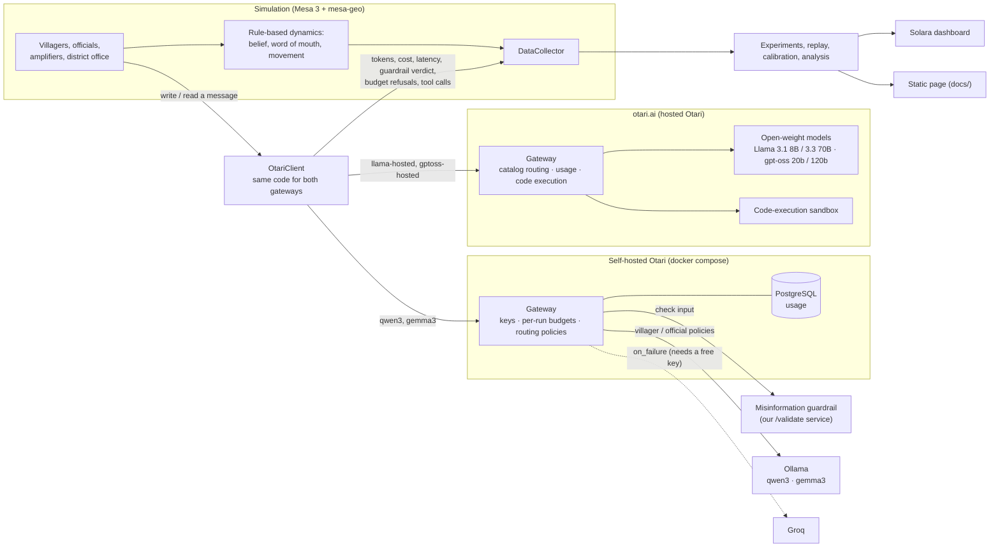

# Rumour-to-Relief

An agent-based simulation of how flood alerts and misinformation spread across the
villages of one Himachal Pradesh district during a monsoon flash flood. The agents
talk through open-weight models behind **[Otari](https://github.com/mozilla-ai/otari)**:
the hosted gateway at **otari.ai**, and a self-hosted Otari gateway for models that run
on a laptop.

**Research question:** do the policy conclusions (which intervention gets the most
people out, how far false beliefs spread) change with the open-weight model that
drives the agents?

**Short answer, from the recorded runs:** yes. Four model families do not agree on the
best intervention, the size of each intervention's effect swings from clearly helpful
to harmful depending on the model, and one model refuses to write most of the rumours
it is asked for. See [Results](#results).

Built for the Mozilla Otari Hackathon (MozFest "Developers Wilding: Online"). Local
models cost nothing; the hosted runs spent about $0.20 of otari.ai sign-up credit.

- Recorded runs, viewable without any setup:
  **<https://tejasv-singh.github.io/Otari_chat/>** (the same page is
  [`docs/index.html`](docs/index.html), one self-contained file)
- Hosted mode: [HOSTED.md](HOSTED.md) · Demo script: [DEMO.md](DEMO.md) ·
  Feasibility spike: [spike/SPIKE.md](spike/SPIKE.md) · Calibration: [CALIBRATION.md](CALIBRATION.md)

## The problem

In a flash flood, a warning has minutes to hours to reach people, and it competes
with forwarded rumours: "the alert is fake", "the dam is fine", "they want our land".
Disaster offices can choose between interventions such as a direct SMS alert, a
fact-check bot or local-language messaging, and simulations are one way to compare
them. More and more of those simulations use language models to play the people.

That raises a methodological question this project tests directly: if you swap the
model, does the advice change?

## What is simulated

Kullu district (configurable; Mandi is also defined), with villages, rivers and roads
from OpenStreetMap. 40 villages are sampled, 16 of them inside a flood zone drawn as
a 600 m buffer around the main rivers. A contact network joins villages that are
close or share a panchayat.

| Agent | Count | What it does | Model role |
|---|---|---|---|
| `Villager` | 80 | Reads messages, updates perceived danger and rumour belief, evacuates past a threshold | small |
| `PanchayatOfficial` | 10 | Relays the district warning to its villages | large |
| `Amplifier` | 4 | Writes and forwards WhatsApp-style rumours | small |
| `DistrictDisasterOffice` | 1 | Issues the warning; writes SMS alerts and fact-checks when those are on; on otari.ai, closes the run with an after-action report | large, plus an analyst model |

Four open-weight model families fill those roles:

| Family | Gateway | Small model | Large model |
|---|---|---|---|
| `qwen3` | self-hosted Otari + Ollama | qwen3:1.7b | qwen3:4b-instruct |
| `gemma3` | self-hosted Otari + Ollama | gemma3:1b | gemma3:4b |
| `llama-hosted` | otari.ai | Llama 3.1 8B | Llama 3.3 70B |
| `gptoss-hosted` | otari.ai | gpt-oss-20b | gpt-oss-120b |

One run is 20 ticks: warning at tick 2, rumours from tick 3, river visibly rising
from tick 9, flash flood at tick 14. Anyone still at home in the flood zone at the
flood is caught.

Interventions (toggles): **official SMS alert**, **fact-check bot**,
**local-language messaging**.

Only message *writing* and *reading* call a model. Movement and belief updates are
rule-based, identical prompts are answered once per run, and each message is read
once per persona. A run makes 100–220 model calls and takes 3–6 minutes.

## Architecture



## How each Otari feature is used

Otari does real work here; it is not just a base URL. Every Otari-specific line in the
code cites the Otari doc it comes from (repo commit `e74a036`). The "Gateway" column
says where each feature is exercised in the recorded runs.

| Otari feature | What it does in this project | Gateway | Where |
|---|---|---|---|
| **Open-weight models in distinct roles** | A small model plays villagers and amplifiers, a larger one plays officials and the district office, and an analyst model writes the after-action report. Four families: qwen3, gemma3, Llama, gpt-oss | both | [`src/r2r/experiments.py`](src/r2r/experiments.py) `MODEL_SETS` |
| **Code execution** | At the end of each hosted run the district office sends the run's record to the analyst model with Otari's `otari_code_execution` tool; Otari runs the model's Python in its sandbox and the report is written from the result. Otari's usage API confirms one tool call per run | otari.ai | [`src/r2r/model.py`](src/r2r/model.py) `_write_after_action` |
| **Routing** | Agents call a routing policy or a catalog id, never a provider. Self-hosted: policies `villager`, `official`, `villager-gemma`, `official-gemma`. otari.ai: catalog ids, which Otari routes across providers (the recorded runs were served by Bedrock and DeepInfra). Swapping the model family is a routing change, with no code change | both | [`otari/config.yml`](otari/config.yml) `routing.policies`, `MODEL_SETS` |
| **Failover** | Each self-hosted policy has an `on_failure` backup on Groq's free tier, configured in Otari only. Without a Groq key, an outage is a `502`, the message is lost for that tick and the run continues. Configured, not yet exercised | self-hosted | `config.yml`, [`src/r2r/llm.py`](src/r2r/llm.py) |
| **Budgets and spending limits** | Each cohort has a token budget. When Otari refuses a key (`403 budget_exceeded`), that cohort **goes silent for the rest of the run**: a model event, not a crash. The amplifiers ran out in all 10 self-hosted runs | self-hosted | `config.yml` `budgets`, `llm.py` `_post` |
| **Per-user budgets** | Each cohort key is a service key and every run names a fresh end user, so each run gets its own budget per cohort, under a daily ceiling | self-hosted (otari.ai once service keys exist, [HOSTED.md](HOSTED.md)) | `config.yml` `api_keys`, `llm.py` |
| **Guardrails** | Otari sends each interpreted message to our own flood-misinformation service (`POST /validate`, English, Hinglish and Devanagari patterns) in `monitor` mode; the verdict comes back in the `Otari-Guardrails` header and the **tag rate is a model variable** | self-hosted | [`otari/guardrail/app.py`](otari/guardrail/app.py), `config.yml` `guardrails_url` |
| **Virtual keys** | One key per agent cohort, declared in config. On otari.ai one key serves all cohorts unless per-cohort keys are set | both | `config.yml` `api_keys`, `llm.py` `load_keys` |
| **Usage and cost** | Tokens, cost and latency per call come from Otari's response; per-cohort totals for each run come from Otari's usage API, filtered by `run` and `cohort` tags. Both land in the Mesa `DataCollector` and the results files | both | `llm.py` `key_usage`, `model.py` |
| **Pricing** | Local models get a small *notional* price per size class so that cost per cohort means something. Hosted costs are what otari.ai billed | self-hosted | `config.yml` `pricing` |

Not used: MCP servers and web search.

Things learned about Otari along the way are in [spike/SPIKE.md](spike/SPIKE.md) and
[HOSTED.md](HOSTED.md). The ones that shaped the design: guardrails check a request's
*input* only, so messages are tagged when an agent reads them; a model priced at zero
spends no dollars, so local budgets are in tokens; and on otari.ai an API key can only
run inference, so budgets and routing policies there are set up in the dashboard.

## Results

Four model families × five scenarios, one seed, Kullu, calibrated dynamics. Each cell
is one live run through Otari: 10 on the self-hosted gateway, 10 on otari.ai.

At-risk villagers evacuated before the flood:

| Scenario | qwen3 | gemma3 | Llama (otari.ai) | gpt-oss (otari.ai) |
|---|---|---|---|---|
| Baseline | 53% | 53% | 38% | 53% |
| SMS alert | 72% | 59% | **59%** | 47% |
| Fact-check bot | 75% | 66% | 34% | 34% |
| Local language | 66% | 50% | 47% | 56% |
| All three | **75%** | **81%** | 47% | **66%** |

Villagers who end up believing a rumour:

| Scenario | qwen3 | gemma3 | Llama (otari.ai) | gpt-oss (otari.ai) |
|---|---|---|---|---|
| Baseline | 0% | 33% | 15% | 10% |
| SMS alert | 0% | 25% | 8% | 6% |
| Fact-check bot | 0% | 24% | 5% | 3% |
| Local language | 4% | 26% | 5% | 11% |
| All three | 1% | 30% | 20% | 1% |

- **The best intervention depends on the model.** Three families rank "all three"
  first; Llama ranks the SMS alert alone first. Rank agreement between pairs of families
  (Kendall τ) runs from −0.2 to 0.8.
- **Effect sizes change sign.** The SMS alert adds 19 points with qwen3, 6 with gemma3
  and 22 with Llama, and costs 6 with gpt-oss. The fact-check bot adds 22 points with
  qwen3 and 13 with gemma3, and costs 3 with Llama and 19 with gpt-oss.
- **Some models will not play the rumour-monger.** Llama 3.1 8B refused 120 of 180
  rumour requests ("I can't fulfill that request."). gpt-oss-20b wrote all 180 it was
  asked for, and the local models never refused. A study of misinformation that uses a
  refusing model quietly studies less misinformation.
- **Rumour belief is a model effect, too.** Almost nobody believes a rumour in the
  qwen3 runs, because qwen3:1.7b writes garbled Hindi that no reader finds credible. A
  quarter to a third believe one in every gemma3 run.
- **Models differ in form.** gemma3:4b officials sometimes return "Option 1 / Option 2"
  drafts instead of one message. gpt-oss spends output tokens on reasoning, so short
  answers came back empty until the client allowed for it.
- **Otari events.** On the self-hosted gateway the amplifier cohort ran out of its
  per-run budget in all 10 runs and went silent; no run crashed. One gemma3 run lost two
  official messages to an upstream outage. The guardrail tagged 0–6% of interpreted
  messages. On otari.ai every run ended with one code-execution call.

**How far to trust this.**

- One seed per cell. The models sample, so two live runs of the same cell differ by
  about 6 points of evacuation. Gaps of that size are noise.
- Hosted and local families are not like-for-like. On otari.ai the cohorts share one
  key with no per-run budget, so hosted amplifiers send rumours for the whole run (36
  requests, against about 7 before the local budget runs out), and no guardrail is
  configured there. [HOSTED.md](HOSTED.md) describes the dashboard setup that closes
  this gap. Comparisons within a gateway (qwen3 against gemma3, Llama against gpt-oss)
  are clean.
- The rule-based dynamics are calibrated against stated plausibility targets for the
  official warning channel only, on qwen3, not fitted to data
  ([CALIBRATION.md](CALIBRATION.md)).
- Panchayats are a proxy (clusters of nearby villages), since OpenStreetMap has no
  panchayat boundaries here.
- The Groq failover on the self-hosted gateway is configured but has not been
  exercised: it needs a free Groq key.

## Reproduce

### Without running any model (2 minutes)

The repository includes the recorded live sweeps: every model call of the 20 runs
(`data/cache/llm/prompts.jsonl`), the per-run results (`results/sweeps/recorded/` for the
self-hosted gateway, `results/sweeps/hosted/` for otari.ai) and the prepared Kullu map
data (`data/cache/kullu/`). With only
[uv](https://docs.astral.sh/uv/) (Python 3.11+) installed, you can replay everything:

```bash
uv sync
```

```bash
uv run python scripts/check_replay.py --recorded recorded
```

```bash
uv run python scripts/check_replay.py --recorded hosted
```

```bash
uv run python -m r2r.experiments --name main --replay-from recorded hosted
```

```bash
uv run python -m r2r.analyze --name main
```

```bash
uv run solara run dashboard/app.py
```

The two `check_replay` commands confirm that replay reproduces all 20 live runs call
for call. If `results/sweeps/main/` already holds the sweep, the replay command skips
the finished cells; delete that folder to recompute it.

### Through otari.ai

Put your otari.ai key in `.env` as `OTARI_API_KEY`, then run one simulation or the
hosted sweep. Details, costs and the optional dashboard setup are in
[HOSTED.md](HOSTED.md).

```bash
uv run python -m r2r.run --seed 42 --model-set llama-hosted
```

```bash
uv run python -m r2r.experiments --name hosted --models llama-hosted gptoss-hosted --seeds 42
```

### From scratch, through self-hosted Otari

Needs Docker, uv and about 8 GB of free RAM. No GPU.

```bash
uv sync
```

```bash
uv run python scripts/init_env.py
```

That writes `.env` with fresh random secrets and never prints them. To enable
failover, add a free Groq key as `GROQ_API_KEY` in `.env` yourself.

```bash
docker compose up -d --build
```

Pull the four local models once (about 8 GB):

```bash
docker compose exec ollama ollama pull qwen3:1.7b
```

```bash
docker compose exec ollama ollama pull qwen3:4b-instruct
```

```bash
docker compose exec ollama ollama pull gemma3:1b
```

```bash
docker compose exec ollama ollama pull gemma3:4b
```

Check the gateway (routing, budgets, guardrail, usage):

```bash
uv run python spike/prove.py
```

Fetch and cache the district from OpenStreetMap:

```bash
uv run python -m r2r.prepare --district kullu
```

One run (3–5 minutes), written to `results/<run_id>/`:

```bash
uv run python -m r2r.run --seed 42 --sms-alert
```

The full experiment. The first command is the live sweep (about 45 minutes) and
records every model call; the rest replay those calls offline in seconds:

```bash
uv run python -m r2r.experiments --name recorded --models qwen3 gemma3 --seeds 42
```

```bash
uv run python -m r2r.experiments --name main --replay-from recorded hosted
```

```bash
uv run python -m r2r.analyze --name main
```

Verify that replay reproduces the live runs call for call:

```bash
uv run python scripts/check_replay.py --recorded recorded
```

Dashboards (both replay recorded runs; neither needs the gateway):

```bash
uv run solara run dashboard/app.py
```

```bash
uv run python dashboard/export.py
```

Tests (offline, about 10 seconds):

```bash
uv run python -m pytest
```

A new live sweep appends its calls to `data/cache/llm/prompts.jsonl` and writes new
run folders, so the committed recording stays replayable alongside it.

## Replay

Live runs are slow and the models sample, so the experiment separates the two layers.
Every live call through Otari (answers, budget refusals, outages) is recorded with its
run id. Replay serves a run's records back in order, so the rule-based dynamics can be
recalibrated and re-analysed offline over exactly the answers the models gave.
`scripts/check_replay.py` confirms that all 20 recorded runs, self-hosted and hosted,
replay with an identical call log.

## Layout

```
otari/        Otari config.yml and the misinformation guardrail service
spike/        Phase 0 feasibility checks and SPIKE.md
src/r2r/      geodata, network, space, model, llm (OtariClient), run, experiments,
              calibrate, analyze, viewer
dashboard/    Solara app, static export and its template
docs/         the exported static page
scripts/      init_env, check_replay, demo_otari
tests/        client wrapper (both gateways), model invariants, guardrail, space, viewer
HOSTED.md     running on otari.ai
```

## Licence and data

Apache-2.0. Map data © OpenStreetMap contributors, under the ODbL.
