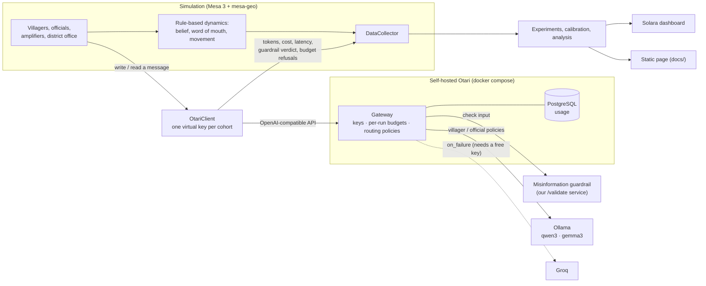

# Rumour-to-Relief

An agent-based simulation of how flood alerts and misinformation spread across the
villages of one Himachal Pradesh district during a monsoon flash flood. The agents
talk through small open-weight models behind a **self-hosted
[Otari](https://github.com/mozilla-ai/otari) gateway**.

**Research question:** do the policy conclusions (which intervention gets the most
people out, how far false beliefs spread) change with the open-weight model that
drives the agents?

**Short answer, from the recorded runs:** both model families pick the same best
intervention, but the size of each intervention's effect and the share of villagers
who believe a rumour depend heavily on the model. See [Results](#results).

Built for the Mozilla Otari Hackathon ("Devs Wilding Online", DoraHacks). Everything
runs on a laptop CPU and costs nothing: no paid APIs, no hosted gateway, no credit card.

- Recorded runs, viewable without any setup:
  **<https://tejasv-singh.github.io/Otari_chat/>** (the same page is
  [`docs/index.html`](docs/index.html), one self-contained file)
- Demo script: [DEMO.md](DEMO.md) · Feasibility spike: [spike/SPIKE.md](spike/SPIKE.md) ·
  Calibration: [CALIBRATION.md](CALIBRATION.md)

## The problem

In a flash flood, a warning has minutes to hours to reach people, and it competes
with forwarded rumours: "the alert is fake", "the dam is fine", "they want our land".
Disaster offices can choose between interventions such as a direct SMS alert, a
fact-check bot or local-language messaging, and simulations are one way to compare
them. More and more of those simulations use language models to play the people.

That raises a methodological question this project tests directly: if you swap the
model, does the advice change?

## What is simulated

Kullu district (configurable; Mandi is also defined), with villages, rivers and roads
from OpenStreetMap. 40 villages are sampled, 16 of them inside a flood zone drawn as
a 600 m buffer around the main rivers. A contact network joins villages that are
close or share a panchayat.

| Agent | Count | What it does | Model |
|---|---|---|---|
| `Villager` | 80 | Reads messages, updates perceived danger and rumour belief, evacuates past a threshold | small (1–2B) |
| `PanchayatOfficial` | 10 | Relays the district warning to its villages | larger (4B) |
| `Amplifier` | 4 | Writes and forwards WhatsApp-style rumours | small (1–2B) |
| `DistrictDisasterOffice` | 1 | Issues the warning; writes SMS alerts and fact-checks when those are on | larger (4B) |

One run is 20 ticks: warning at tick 2, rumours from tick 3, river visibly rising
from tick 9, flash flood at tick 14. Anyone still at home in the flood zone at the
flood is caught.

Interventions (toggles): **official SMS alert**, **fact-check bot**,
**local-language messaging**.

Only message *writing* and *reading* call a model. Movement and belief updates are
rule-based, identical prompts are answered once per run, and each message is read
once per persona. A run makes about 100 model calls and takes 3–5 minutes on a
laptop CPU.

## Architecture



## How each Otari feature is used

Otari does real work here; it is not just a base URL. Every Otari-specific line in the
code cites the Otari doc it comes from (repo commit `e74a036`).

| Otari feature | What it does in this project | Where |
|---|---|---|
| **Virtual keys** | One key per agent cohort (villager, official, amplifier, district office), declared in config | [`otari/config.yml`](otari/config.yml) `api_keys`, [`src/r2r/llm.py`](src/r2r/llm.py) |
| **Budgets** | Each cohort key is a service key; every run names a fresh end user, so each cohort gets a fresh **per-run token budget**, under a daily ceiling. When Otari refuses a key (`403 budget_exceeded`), that cohort **goes silent for the rest of the run**: a model event, not a crash | `config.yml` `budgets`, `llm.py` `_post` |
| **Routing policies** | Agents call a policy name, not a model: `villager` and `official` (qwen3), `villager-gemma` and `official-gemma` (gemma3). Swapping the model family is a routing change, with no code change | `config.yml` `routing.policies` |
| **Failover** | Each policy has an `on_failure` backup on Groq's free tier, configured in Otari only. Without a Groq key, an outage is a `502`, the message is lost for that tick and the run continues | `config.yml`, `llm.py` |
| **Guardrails** | Otari sends each interpreted message to our own flood-misinformation service (`POST /validate`, English, Hinglish and Devanagari patterns) in `monitor` mode; the verdict comes back in the `Otari-Guardrails` header and the **tag rate is a model variable** | [`otari/guardrail/app.py`](otari/guardrail/app.py), `config.yml` `guardrails_url` |
| **Usage and cost** | Tokens, cost and latency per call come from Otari's response; per-key totals for each run come from Otari's usage API, filtered by a run tag. Both land in the Mesa `DataCollector` and the results files | `llm.py` `key_usage`, [`src/r2r/model.py`](src/r2r/model.py) |
| **Pricing** | Local models get a small *notional* price per size class so that cost per cohort means something. These are not real charges | `config.yml` `pricing` |
| **Dashboard** | Keys, budgets, routing and the request log are visible at `http://localhost:8000/` | [DEMO.md](DEMO.md) |

Things learned about self-hosted Otari along the way are in [spike/SPIKE.md](spike/SPIKE.md).
The two that shaped the design: guardrails check a request's *input* only, so messages
are tagged when an agent reads them; and a model priced at zero spends no dollars, so
budgets are in tokens.

## Results

Two model families × five scenarios, one seed, Kullu, calibrated dynamics. Each cell is
one live run through Otari (10 runs, about 45 minutes in total).

| Scenario | Evacuated at risk, qwen3 | Evacuated at risk, gemma3 | Believe a rumour, qwen3 | Believe a rumour, gemma3 |
|---|---|---|---|---|
| Baseline | 53% | 53% | 0% | 33% |
| SMS alert | 72% | 59% | 0% | 25% |
| Fact-check bot | 75% | 66% | 0% | 24% |
| Local language | 66% | 50% | 4% | 26% |
| All three | 75% | 81% | 1% | 30% |

- **Ranking mostly agrees.** qwen3: all > fact-check > SMS > local language > baseline.
  gemma3: all > fact-check > SMS > baseline > local language. Kendall τ = 0.8, same best
  intervention.
- **Effect sizes do not agree.** The SMS alert adds 19 points with qwen3 and 6 with
  gemma3. Local-language messaging adds 12.5 points with qwen3 and costs 3 with gemma3.
- **Rumour belief is the clearest model effect.** Almost nobody believes a rumour in
  the qwen3 runs; a quarter to a third do in every gemma3 run. The cause is visible in
  the messages: qwen3:1.7b writes garbled Hindi rumours that no reader finds credible.
- **Models differ in form, too.** gemma3:4b officials sometimes return "Option 1 /
  Option 2" drafts instead of one message, and gemma3:1b at least once dropped part of the
  required answer format.
- **Otari events.** The amplifier cohort ran out of its per-run budget in all 10 runs
  and went silent; no run crashed. One gemma3 run lost two official messages to an
  upstream outage. The guardrail tagged 0–6% of interpreted messages.

**How far to trust this.** One seed per cell. The models sample, so two live runs of
the same cell differ by about 6 points of evacuation. Gaps of that size are noise; the
rumour-belief gap and the direction of the rankings are not, but the effect-size
differences need more seeds before they are claims. The rule-based dynamics are
calibrated against stated plausibility targets for the official warning channel only,
not fitted to data ([CALIBRATION.md](CALIBRATION.md)). Panchayats are a proxy (clusters
of nearby villages), since OpenStreetMap has no panchayat boundaries here. The Groq
failover is configured but has not been exercised: it needs a free Groq key.

## Reproduce

### Without running any model (2 minutes)

The repository includes the recorded live sweep: every model call of the 10 runs
(`data/cache/llm/prompts.jsonl`), the per-run results (`results/sweeps/recorded/`) and
the prepared Kullu map data (`data/cache/kullu/`). With only
[uv](https://docs.astral.sh/uv/) (Python 3.11+) installed, you can replay everything:

```bash
uv sync
```

```bash
uv run python scripts/check_replay.py --recorded recorded
```

```bash
uv run python -m r2r.experiments --name main --replay-from recorded
```

```bash
uv run python -m r2r.analyze --name main
```

```bash
uv run solara run dashboard/app.py
```

The first command after `uv sync` checks that replay reproduces all 10 live runs call
for call. If `results/sweeps/main/` already holds the sweep, the replay command skips
the finished cells; delete that folder to recompute it.

### From scratch, through Otari

Needs Docker, uv and about 8 GB of free RAM. No GPU.

```bash
uv sync
```

```bash
uv run python scripts/init_env.py
```

That writes `.env` with fresh random secrets and never prints them. To enable
failover, add a free Groq key as `GROQ_API_KEY` in `.env` yourself.

```bash
docker compose up -d --build
```

Pull the four local models once (about 8 GB):

```bash
docker compose exec ollama ollama pull qwen3:1.7b
```

```bash
docker compose exec ollama ollama pull qwen3:4b-instruct
```

```bash
docker compose exec ollama ollama pull gemma3:1b
```

```bash
docker compose exec ollama ollama pull gemma3:4b
```

Check the gateway (routing, budgets, guardrail, usage):

```bash
uv run python spike/prove.py
```

Fetch and cache the district from OpenStreetMap:

```bash
uv run python -m r2r.prepare --district kullu
```

One run (3–5 minutes), written to `results/<run_id>/`:

```bash
uv run python -m r2r.run --seed 42 --sms-alert
```

The full experiment. The first command is the live sweep (about 45 minutes) and
records every model call; the rest replay those calls offline in seconds:

```bash
uv run python -m r2r.experiments --name recorded --models qwen3 gemma3 --seeds 42
```

```bash
uv run python -m r2r.experiments --name main --replay-from recorded
```

```bash
uv run python -m r2r.analyze --name main
```

Verify that replay reproduces the live runs call for call:

```bash
uv run python scripts/check_replay.py --recorded recorded
```

Dashboards (both replay recorded runs; neither needs the gateway):

```bash
uv run solara run dashboard/app.py
```

```bash
uv run python dashboard/export.py
```

Tests (offline, about 10 seconds):

```bash
uv run python -m pytest
```

A new live sweep appends its calls to `data/cache/llm/prompts.jsonl` and writes new
run folders, so the committed recording stays replayable alongside it.

## Replay

Live runs are slow and the models sample, so the experiment separates the two layers.
Every live call through Otari (answers, budget refusals, outages) is recorded with its
run id. Replay serves a run's records back in order, so the rule-based dynamics can be
recalibrated and re-analysed offline over exactly the answers the models gave.
`scripts/check_replay.py` confirms that all 10 recorded runs replay with an identical
call log.

## Layout

```
otari/        Otari config.yml and the misinformation guardrail service
spike/        Phase 0 feasibility checks and SPIKE.md
src/r2r/      geodata, network, space, model, llm (OtariClient), run, experiments,
              calibrate, analyze, viewer
dashboard/    Solara app, static export and its template
docs/         the exported static page
scripts/      init_env, check_replay, demo_otari
tests/        client wrapper, model invariants, guardrail, space, viewer
```

## Licence and data

Apache-2.0. Map data © OpenStreetMap contributors, under the ODbL.
